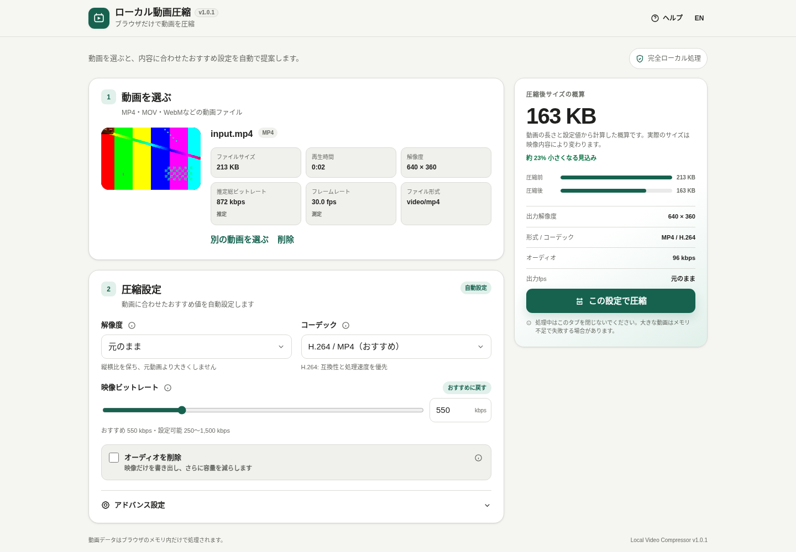

# Local Video Compressor

[](https://github.com/ttomohisa/htmlapps-video-compressor/actions/workflows/deploy-pages.yml)
[](LICENSE)
[](https://ttomohisa.github.io/htmlapps-video-compressor/)

[日本語版 README](README.ja.md)

A single-HTML video compressor that keeps processing inside the browser. It can output **H.264 / AAC MP4** for broad compatibility or **VP9 / Opus WebM** when smaller files are preferred. The engine is the compact FFmpeg 9 WebAssembly build produced by [`htmlapps-ffmpeg-wasm-builder`](https://github.com/ttomohisa/htmlapps-ffmpeg-wasm-builder), with a portable single-thread variant and an explicitly isolated multi-thread variant.



## 🚀 Live demo

- [Single-thread / portable demo (GitHub Pages)](https://ttomohisa.github.io/htmlapps-video-compressor/)
- [Multi-thread / isolated demo (GitHub Pages)](https://ttomohisa.github.io/htmlapps-video-compressor/mt/)

The Multi-thread demo may reload once on first use to enable cross-origin isolation. Only the GitHub Pages `/mt/` entry loads a same-origin Service Worker helper.

> **CSP note:** `script-src` includes the narrow `'wasm-unsafe-eval'` permission required for WebAssembly. The broader JavaScript `'unsafe-eval'` token is not enabled, and `connect-src 'none'` blocks runtime network access.

## Features

- H.264 / AAC / MP4 output for compatibility and faster browser-side encoding
- VP9 / Opus / WebM output for higher compression when encoding time is acceptable
- Source video bitrate measured from actual video-stream packets, with a codec/dimension-aware recommended output bitrate selected by default
- Display-matrix rotation applied to output pixels so portrait/rotated MP4/MOV stays correctly oriented
- Resolution changes with aspect-ratio preservation and no upscaling
- Output frame rate, encoding speed, and audio bitrate controls
- Optional audio removal
- Estimated output size based on the selected output bitrate and duration
- Small videos (up to 32 MiB) are read once after selection and supplied through MEMFS, avoiding later FileReaderSync permission failures
- Larger videos keep WORKERFS input so they are not copied wholesale into MEMFS before processing
- Compression can start before the video-bitrate inspection completes; the current settings are used and inspection is stopped safely
- Progress, processing log, and cancellation
- Preview, save, and share output
- Editable next-run output file name with automatic `.mp4` / `.webm` extension handling
- Rename the completed result before saving or sharing, without recompressing or changing its actual format
- Japanese and English UI
- No media upload or runtime media-data network access (GitHub Pages /mt/ loads a same-origin isolation helper during startup)
- Responsive desktop/mobile UI
- Mobile bottom action bar for Video, Settings, Estimate, and Compress

## FFmpeg WASM dependency

The repository does not commit the large generated WASM binary. `dependencies.json` contains a **single pinned FFmpeg WASM Builder version**. During the build, the matching GitHub Release is downloaded and verified against its `SHA256SUMS.txt`, then `ffmpeg.js` and `ffmpeg.wasm` are embedded into the standalone HTML.

Current pin:

```json
"version": "1.10.3"
```

Builder v1.10.3 fixes final-frame MP4 duration and preserves Original-FPS timestamps. Builder v1.6.0 originally added libvpx VP9, Opus, source-stream inspection, autorotation, and WORKERFS input to the `video-compressor` profile. The runtime never downloads FFmpeg from GitHub.

## Build on Windows

Run:

```text
build-standalone.bat
```

The build creates:

```text
dist/
├─ index.html
├─ index.self-extract.html
├─ dependency-manifest.json
├─ self-extract-manifest.json
└─ .nojekyll

video-compressor.html   # copy of dist/index.html
```

Generate only the readable build with:

```powershell
.\build-standalone.ps1 -SkipSelfExtract
```

Force a fresh verified Release download with:

```powershell
.\build-standalone.ps1 -ForceDownload
```

To test a Builder change before publishing a Release, build the Builder's `video-compressor` profile first, then point the app directly at that output:

```text
build-with-local-ffmpeg.bat ..\htmlapps-ffmpeg-wasm-builder\dist\video-compressor
```

This local integration path is for development verification only. Release builds still download the pinned GitHub Release assets and verify them against `SHA256SUMS.txt`.

## Update FFmpeg

When a new Builder release is ready, update one version number and rebuild with:

```text
update-ffmpeg.bat 1.10.3
```

The script updates `dependencies.json`, downloads the matching Release, verifies its SHA-256, and rebuilds the standalone files.

## Usage

1. Choose or drop a video.
2. Once basic file information is ready, you can compress immediately. Source bitrate inspection continues separately, and the recommended output bitrate may update when it finishes.
3. Choose **H.264 / MP4** or **VP9 / WebM**.
4. Adjust resolution, bitrate, frame rate, encoding speed, audio settings, and the output file name when needed.
5. Select **Compress with these settings**. On mobile, the bottom **Compress** action is also available. If inspection is still running, the app cancels inspection and encodes with your currently displayed settings.
6. Preview, save, or share the generated MP4/WebM file.

H.264 remains the default because it is generally faster to encode and broadly compatible. VP9 is intended for cases where a smaller file is worth longer browser-side encoding time.

## Privacy and offline architecture

- `connect-src 'none'` blocks runtime connections.
- No external CDN, analytics, ads, or remote fonts.
- Input and output video data are not persisted.
- `ffmpeg.js` and `ffmpeg.wasm` are embedded into one HTML file.
- FFmpeg runs in a dedicated Worker.
- Source videos up to 32 MiB are captured once into temporary memory and copied to the FFmpeg Worker via MEMFS; larger videos use WORKERFS to avoid a full input copy. Nothing is uploaded or persisted.
- WASM bytes are instantiated directly through `instantiateWasm`, avoiding runtime URL resolution under `file://`.
- Generated core JavaScript and the app Worker code share one Blob; no nested `importScripts()` is used.
- ST requires neither SharedArrayBuffer nor COOP/COEP. MT requires all three and reports a clear error on unsupported hosts.

See [docs/ARCHITECTURE.md](docs/ARCHITECTURE.md) and [VERIFY_OFFLINE.md](VERIFY_OFFLINE.md).

## Development

Key files:

- `dependencies.json`: pinned Builder version and Release assets
- `src/index.template.html`: UI and application logic
- `build-standalone.ps1`: Release download, checksum verification, and embedding
- `build-with-local-ffmpeg.bat`: development build using a local Builder `dist/video-compressor` output
- `update-ffmpeg.bat`: Builder version update helper
- `scripts/check-repository.ps1`: source, standalone, and Pages distribution verification
- `scripts/prepare-pages.ps1`: builds the GitHub Pages ST/MT staging directory
- `coi-serviceworker.lock.json`: SHA-256 pin for the Pages-only MT isolation helper
- `THIRD_PARTY_NOTICES.md`: third-party licensing and corresponding-source details

```powershell
powershell -ExecutionPolicy Bypass -File scripts/check-repository.ps1
```

## License

This application repository is **GPL-3.0-or-later**. The generated FFmpeg/x264/libvpx/Opus WebAssembly core from `htmlapps-ffmpeg-wasm-builder` is distributed under **GPL-2.0-or-later** because the profile links GPL x264. libvpx and Opus retain their own upstream notices and patent grants inside the Builder release bundle.

The generated app also exposes the Builder version and corresponding-source link in its Help dialog. See [THIRD_PARTY_NOTICES.md](THIRD_PARTY_NOTICES.md).

## Source lifecycle regression checks

Install Node.js 22 or newer in addition to PowerShell. Run `node scripts/test-source-lifecycle.cjs` for the source checks, or pass an HTML path to check a readable standalone build. `scripts/check-repository.ps1` checks the source and checked-in root HTML before building, then checks the generated standalone HTML and root parity. Rebuild with `build-standalone.ps1` after changing the template.

The tests execute the actual inline app with controlled DOM/media events, Worker messages, timers and embedded-core preparation. Tiny fictional file metadata and output bytes cover selection replacement/removal, stale callbacks, cancel/retry, resource disposal, H.264/VP9 arguments and output naming. They do not decode video, instantiate WASM, or replace the manual browser, real-video, offline, save/share and mobile checks in `VERIFY_OFFLINE.md`.

## Single-thread and multi-thread builds

The default build produces both ST (`index.html` / `video-compressor.html`) and MT (`index.mt.html` / `video-compressor.mt.html`), plus matching self-extracting files and separate manifests. Both retain MP4 and WebM. ST supports direct disk use; MT requires an isolated HTTP(S) host and SharedArrayBuffer.

GitHub Pages now publishes [Single-thread at `/`](https://ttomohisa.github.io/htmlapps-video-compressor/) and [Multi-thread at `/mt/`](https://ttomohisa.github.io/htmlapps-video-compressor/mt/). Pages cannot set custom COOP/COEP headers, so only the dedicated `/mt/` entry uses a pinned, same-origin `coi-serviceworker` to supply isolation after one reload. The Pages-specific CSP allows same-origin scripts/workers without broadening `connect-src 'none'`; it does not change the raw standalone distribution.

Browser Kitty imports the raw MT HTML and supplies route-specific COOP/COEP headers without installing a Service Worker. Unsupported MT environments show an explanation rather than silently switching to ST. See [ST / MT distribution](docs/MULTITHREAD.md).
